# LeRobot + ACT：工业仪表自主擦拭机械臂模仿学习

> 基于 **SO-101 六自由度主从机械臂** + **Action Chunking Transformer (ACT)** 的工业仪表表面清洁系统：完成 **201 episodes / 8 类受控工况**示教数据集工程化设计、**AutoDL RTX 4090（100,000 steps / ~6.6h）** 云端训练、本地实机闭环部署与**失败样本回放微调（76.8% → 91.2% 综合成功率）**，已在真实工业管网仪表场景完成外场实测（**CRAIC 2026 第二十八届中国机器人及人工智能大赛 · 机器人创新赛**）。

[](https://github.com/ffgxfvy/lerobot-act-wiping-arm/actions/workflows/ci.yml)

---

## 核心指标与成果速览

| 指标 | 数值 / 事实 | 说明 |
|---|---|---|
| **任务综合成功率** | **76.8% → 91.2%**（**+14.4 pp**） | 见[阶段消融数据](docs/technical-report.md)：单视角基线 → 双视角融合 → 补偿样本 → 轨迹优化 → 失败样本微调 |
| **系统数据集规模** | **201 episodes**（8 类受控工况） | 双视角 640×480 @ 30fps（`cam_high` + `cam_wrist`）+ 7 维关节/夹爪状态 |
| **动作块输出** | 滚动时域 Action Chunking | 6 DoF 关节目标 + 夹爪开合，缓解局部遮挡与高频抖动 |
| **云端训练算力** | AutoDL RTX 4090 24GB | `batch_size=32`, `steps=100,000`（~6.6h），`L1 / smooth L1` 动作块监督 |
| **实机闭环能力** | 抓取 → 定位 → 污渍判断 → **二次补擦** → 复位 | 支持轻/重污渍识别与失败样本低学习率增量微调 |

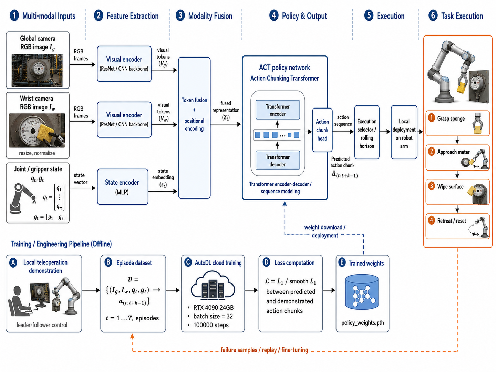

---

## 实机演示（真机采集 · 闭环补擦 · 工业现场）

<table>
  <tr>
    <td align="center" width="33%">
      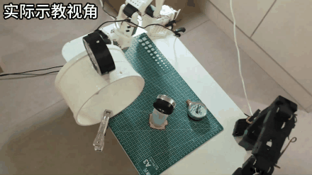<br/>
      <sub><b>1. 主从遥操作示教采集</b><br/>双视角 RGB + 舵机状态同步录制</sub>
    </td>
    <td align="center" width="33%">
      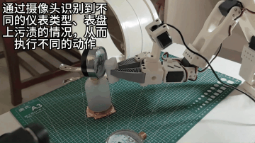<br/>
      <sub><b>2. 污渍状态识别与二次补擦闭环</b><br/>残留污渍自动复擦后安全复位</sub>
    </td>
    <td align="center" width="33%">
      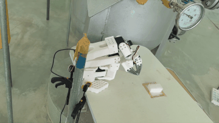<br/>
      <sub><b>3. 真实工业管网与仪表外场实测</b><br/>跨环境背景迁移擦拭验证</sub>
    </td>
  </tr>
</table>

<p align="center">
  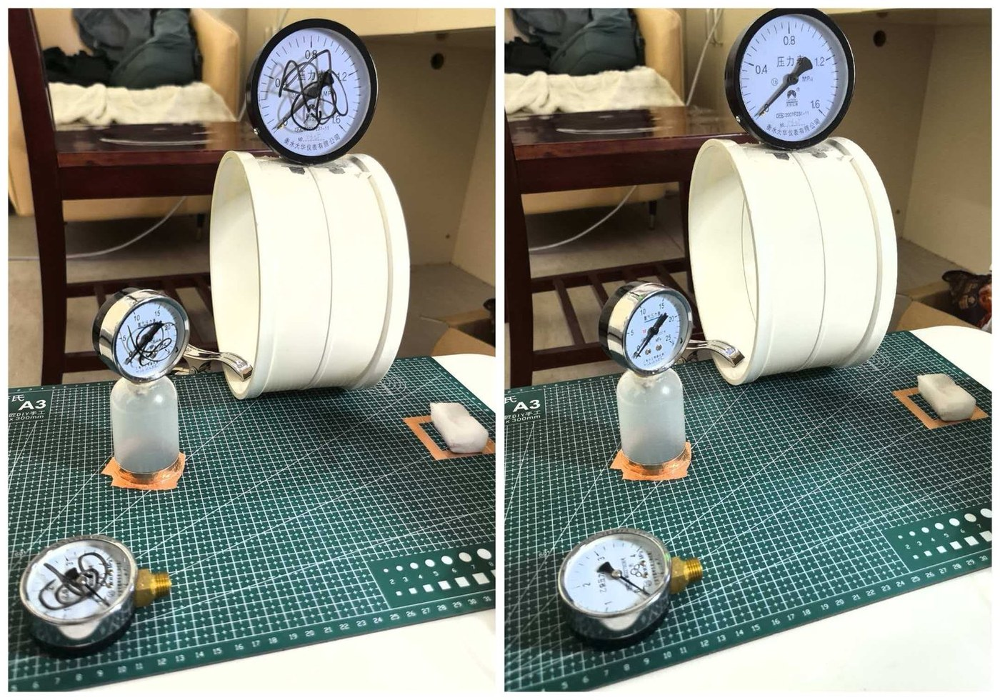<br/>
  <sub>图：三种不同尺寸/倾角模拟工业仪表擦拭前后效果对比</sub>
</p>

---

## 系统设计与工程闭环

### 1. 硬件与双视角观测拓扑

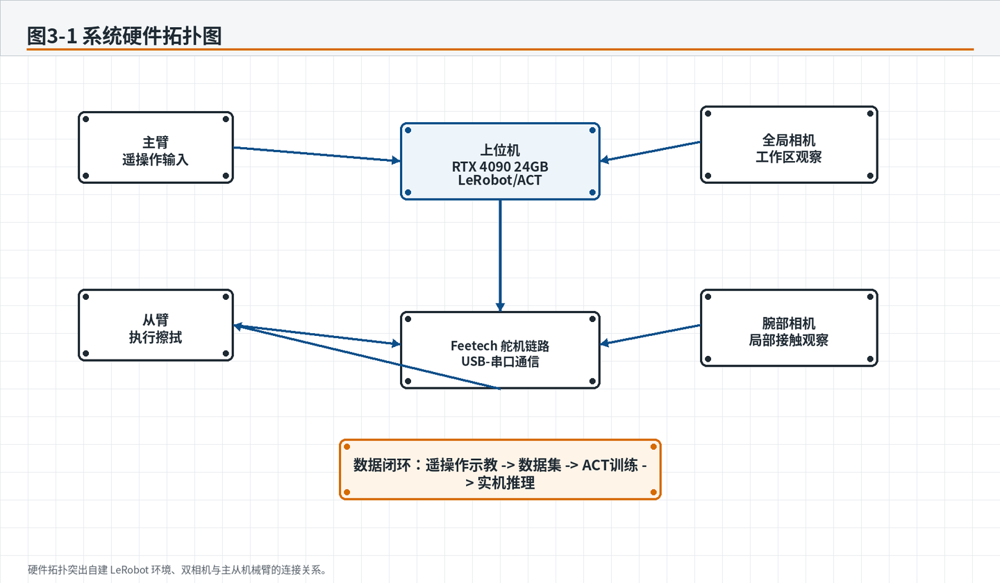

| 部件 | 规格与角色 |
|---|---|
| **机械臂套件** | SO-101 6-DoF 主从机械臂（`so101_leader` 示教主臂 / `so101_follower` 执行从臂），Feetech 串行总线舵机 |
| **双路视觉输入** | 全局相机 `cam_high`（640×480 @ 30fps，工作区位姿与安全边界）+ 腕部相机 `cam_wrist`（局部海绵接触与表盘污渍残留判断） |
| **本体本体感受** | 6 个关节角度 $q_t$ + 夹爪状态 $g_t$ |
| **控制动作输出** | 连续动作块 $\hat{a}_{t:t+k-1}$，滚动时域平滑执行 |

<details>
<summary>查看桌面训练工位与工业现场实拍图</summary>

| 桌面主从示教与多角度标定工位 | 工业现场压力表实测部署 |
|---|---|
| 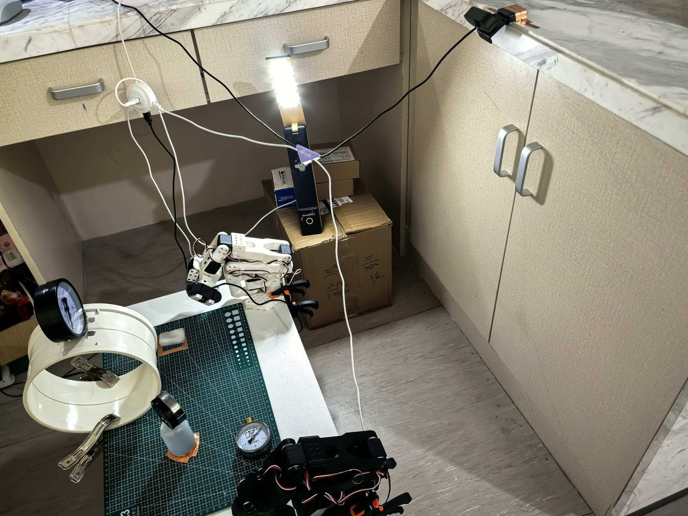 | 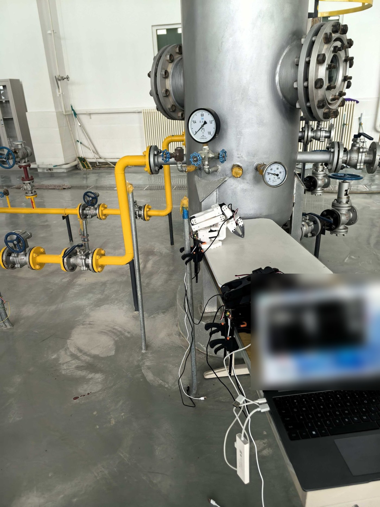 |

</details>

---

### 2. 数据集工程（201 Episodes · 8 类受控扰动工况）

**核心方法论：把"失败原因"前置成受控数据集维度，而不是盲目堆积随机录像。**

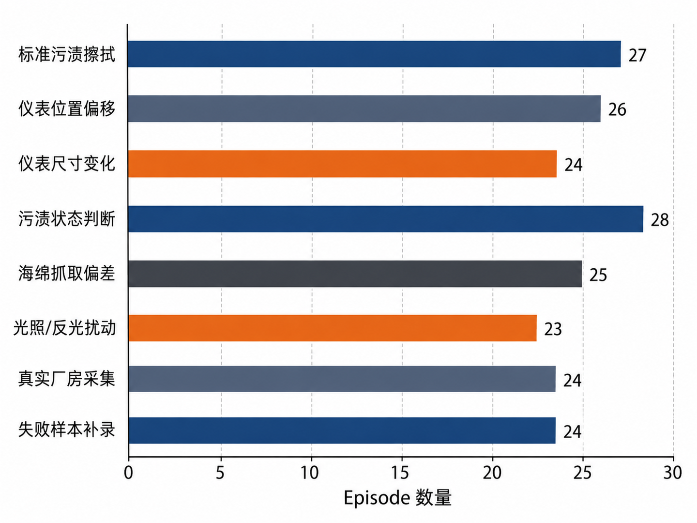

| 工况分类 | Episode 数 | 占比 | 针对性解决的失效模式 |
|---|---:|---:|---|
| 标准污渍擦拭 | 27 | 13.4% | 基础全流程（抓→擦→放）锚点 |
| 仪表位置偏移 | 26 | 12.9% | 表盘平移/旋转导致末端抓空 |
| 仪表尺寸变化 | 24 | 11.9% | 大/中/小口径表盘轨迹自适应 |
| 污渍状态判断 | 28 | 13.9% | 重污渍补擦 vs 无污渍直接复位决策 |
| 海绵抓取偏差 | 25 | 12.4% | 夹爪持具偏斜后的腕部补偿策略 |
| 光照/反光扰动 | 23 | 11.4% | 玻璃表盘强光反射引起的视觉退化 |
| 真实厂房采集 | 24 | 11.9% | Sim-to-Plant 背景域偏移 |
| **失败样本补录** | 24 | 11.9% | 实机部署暴露失败后按同一状态复现并人工纠偏 |
| **合计** | **201** | **100.0%** | 可通过 [`scripts/dataset_stats.py`](scripts/dataset_stats.py) 导出统计 JSON |

---

### 3. 消融实验、污渍判别与实机闭环结果

| 模型配置 | 主要输入或策略 | 任务完成率 | 较基线提升 |
|---|---|---:|---:|
| **单全局视角模型** | 全局相机图像（`cam_high`） | 76.8% | 基线 |
| **双视角模型** | 全局图像 + 腕部图像（`cam_high + cam_wrist`） | 84.5% | +7.7 pp |
| **双视角 + 关节状态模型** | 全局图像 + 腕部图像 + 6 DoF 关节/夹爪状态 | 88.1% | +11.3 pp |
| **ACT 动作分块模型** | 多模态输入 + 连续动作块输出（Action Chunking） | 89.4% | +12.6 pp |
| **ACT + 失败样本微调** | 多模态输入 + 动作分块 + 24 条失败样本补录微调 | **91.2%** | **+14.4 pp** |

<table>
  <tr>
    <td width="52%">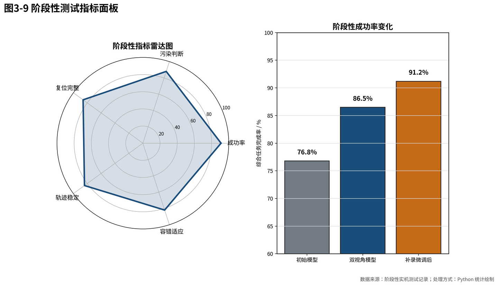</td>
    <td width="48%">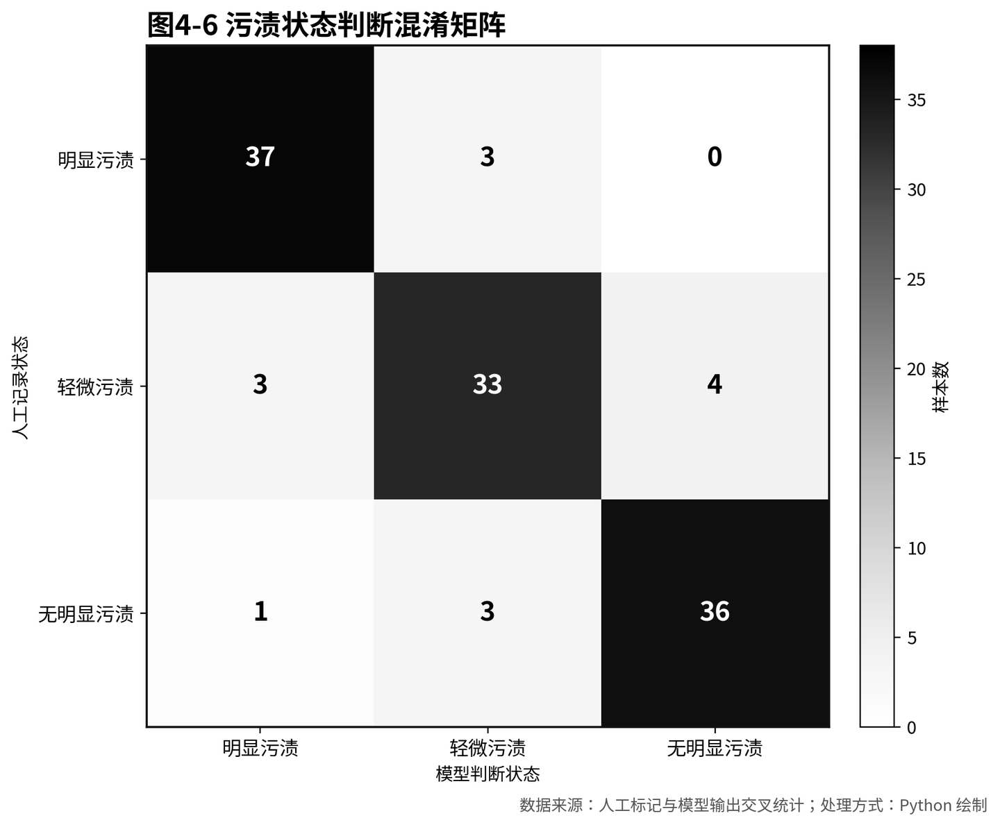</td>
  </tr>
</table>

> 完整实验分析（含分段耗时、末端误差分布、失败模式拆解）详见 [`docs/technical-report.md`](docs/technical-report.md) 与参赛匿名研究报告 [`docs/项目研究报告.pdf`](docs/项目研究报告.pdf)。

---

## 脚本、脱敏配置与本地自动化校验

所有可复用配置与离线校验工具位于 [`scripts/`](scripts/) 与 [`tests/`](tests/)：

```text
lerobot-act-wiping-arm/
├── .github/workflows/ci.yml            # GitHub Actions 自动校验脚本/配置/统计一致性
├── assets/                             # 架构图、数据集统计、消融图、对比照片与 3 组实机 GIF
├── docs/
│   ├── technical-report.md             # 完整技术报告（Markdown）
│   ├── 项目研究报告.pdf                 # CRAIC 2026 匿名参赛研究报告（30 页）
│   ├── dataset-design.md               # 201 episodes 工况设计文档
│   ├── lerobot-environment-setup.md    # SO-101 标定、相机枚举与 LeRobot 环境搭建
│   ├── cloud-training-autodl.md        # AutoDL RTX 4090 离线训练与合并微调全流程
│   └── local-deployment.md             # 实机部署命令、安全护栏与踩坑记录
├── scripts/
│   ├── record_task.yaml                # 脱敏后遥操作采集配置（${FOLLOWER_PORT} / ${HF_USER}）
│   ├── deploy_task.yaml                # 脱敏后实机推理部署配置
│   ├── train_act.sh                    # 从零训练 ACT 策略脚本（AutoDL 离线环境）
│   ├── finetune.sh                     # 增量微调脚本（基于 pretrained checkpoint）
│   ├── merge_datasets.sh               # 多阶段 LeRobot 数据集合并脚本
│   ├── eval_checkpoint.sh              # 实机 checkpoint 评测脚本
│   ├── check_env.py                    # CUDA / PyTorch / LeRobot / HF 缓存自检工具
│   └── dataset_stats.py                # 8 工况 / 5 消融阶段统计及本地 parquet 元信息扫描
└── tests/
    └── test_repo_artifacts.py          # 配置脱敏、LF 行尾、HTML 实体与统计一致性 pytest
```

### 快速检查与运行测试

```bash
# 1. 运行脱敏配置、脚本语法、行尾与报告统计一致性测试
pytest tests -v

# 2. 离线查看数据集工况分布与消融数据（JSON）
python scripts/dataset_stats.py --json

# 3. 检查本地 CUDA / PyTorch / LeRobot / 缓存变量状态
python scripts/check_env.py --json
```

---

## 工程踩坑实录（已沉淀为可复用规范）

1. **CUDA/PyTorch 隐式降级**：AutoDL 部分镜像混入 CPU torch 会触发 `Switching to 'cpu'`，必须在重装 CUDA 12.4 wheel 后用 `torch.cuda.is_available()` 强校验；
2. **`draccus` CLI 参数语法红线**：LeRobot v0.4 必须使用 `--key=value`、全小写布尔值 `false`/`true`、且严禁行尾误吞转义符；
3. **离线缓存目录契约**：需同时锁定 `HF_HOME` / `HF_LEROBOT_HOME` 与 `HF_HUB_OFFLINE=1`，并将 checkpoint 精准指向含 `config.json` 与 `.safetensors` 的最深目录；
4. **物理急停与视角鲁棒性**：ACT 对双目外参敏感，[`scripts/deploy_task.yaml`](scripts/deploy_task.yaml) 默认将 `num_episodes` 设为 1 并配合急停开关人工监控。

---

## 个人职责与边界声明

- **个人职责**：项目负责人。负责任务拆解、8 类扰动工况设计与 201 条遥操作样本采集清洗、ACT 模型训练/消融实验、AutoDL → 本地实机闭环部署及失败样本微调迭代、研究报告主笔与现场实测。
- **客观边界**：SO-101 机械臂为标准化开源硬件套件，底层框架基于 Hugging Face [LeRobot](https://github.com/huggingface/lerobot)；本仓库核心工程贡献在于**面向工业维护场景的数据集工况设计方法论、多视角微调数据飞轮、云端—本地实战运维流程及脱敏脚本体系**。
- 演示原视频（百 MB 级 MP4）与原始数据集体量较大，未直接纳入 Git；仓库已提供完整脱敏配置文件、实测 GIF 与全部复现脚本。
