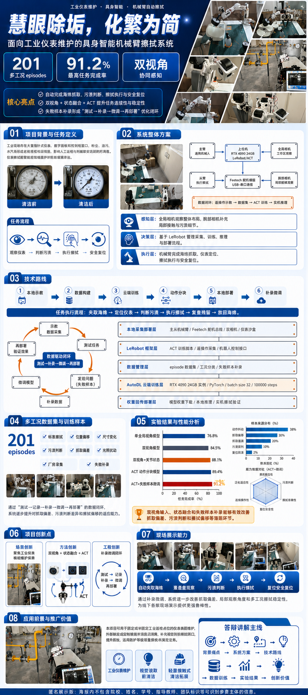

# LeRobot + ACT：工业仪表擦拭机械臂模仿学习

> 用 **ACT（Action Chunking Transformer）** 端到端模仿学习，让 SO-101 六自由度机械臂学会"抓海绵 → 定位仪表 → 判断污渍 → 擦拭 → 复位"。
> **201 个 episode** 的多工况示教数据集 · **AutoDL RTX 4090** 云端训练 · **实机部署** + 失败样本回溯微调闭环。



## 项目背景

工业现场的指针式仪表、数字面板、控制柜窗口数量多、分布散，表面污染（粉尘、油污、水汽、反光）会降低人工读数与机器视觉识别的可靠性。仪表擦拭这个任务**单次操作不复杂，但重复性强、点位众多、工具接触状态不稳定**——正是具身智能进入工业维护场景的一个合适切入点。

项目参加**第二十八届中国机器人及人工智能大赛（CRAIC 2026）机器人创新赛**。

## 系统构成

```
   全局相机 (cam_high)  ──┐
   腕部相机 (cam_wrist) ──┤
   关节状态 q_t (6 DoF) ──┤──► 视觉编码器 / 状态编码器 ──► 模态融合 ──► ACT 策略网络
   夹爪状态 g_t        ──┘                                                    │
                                                                              ▼
                                                            动作块 a_{t:t+k-1}（未来一段连续动作）
                                                                              │
                                                              ┌───────────────┘
                                                              ▼
                                                  本地机械臂执行 → 失败样本补录 → 云端微调
```

| 部件 | 说明 |
|---|---|
| 机械臂 | SO-101 主从臂（`so101_leader` 主臂 / `so101_follower` 从臂），Feetech 舵机，串口通信 |
| 相机 | 双路 USB 相机：全局视角（观察整体位置关系）+ 腕部视角（补充末端局部接触信息） |
| 观测 | 全局图像 `I_g`、腕部图像 `I_w`、关节状态 `q_t`（6 电机角度）、夹爪状态 `g_t` |
| 动作 | ACT 输出的动作块（连续多步动作），滚动时域下发 |
| 训练平台 | AutoDL 租用 **RTX 4090 24GB** |

## 数据集设计（本项目最能体现方法论的部分）

**共 201 个 episode**，按**工况类型**系统划分而不是随机采集——这是为了让模型在受控条件下暴露并学会处理各种干扰：

| 工况类型 | Episode 数 | 采集目的 |
|---|---|---|
| 标准污渍擦拭 | 27 | 学习完整擦拭任务基准动作 |
| 仪表位置偏移 | 26 | 增强目标位置变化的适应能力 |
| 仪表尺寸变化 | 24 | 覆盖目标尺度差异 |
| 污渍状态判断 | 28 | 学习不同污渍状态下的动作差异 |
| 海绵抓取偏差 | 25 | 提升工具夹持偏差的容错能力 |
| 光照/反光扰动 | 23 | 提升视觉输入稳定性 |
| 真实厂房采集 | 24 | 补充实际环境图像与背景变化 |
| **失败样本补录** | 24 | 针对实机失败状态进行微调 |
| **合计** | **201** | — |

> **为什么这个划分重要**：如果只是"随便采 200 条"，模型学到的只是标准工况。这 8 类工况是先用任务分析推导出"可能失败的原因"，再针对性设计采集策略——**这是数据工程，不是录视频**。最后 24 条失败样本是实机部署后回补的，形成了"部署 → 发现失败 → 补数据 → 微调"的闭环。

## 训练与部署闭环

```
   ① 本地示教                     ② 云端训练                    ③ 本地部署
┌──────────────────┐        ┌────────────────────┐      ┌──────────────────┐
│ 主从遥操作采集    │        │ AutoDL RTX 4090 24G│      │ 权重下载回本地    │
│ 201 episodes     │ ─────► │ batch 32           │────► │ 实机推理验证      │
│ 双相机 + 关节状态 │        │ 100,000 steps      │      │ 评估鲁棒性        │
└──────────────────┘        │ 约 6.6 小时         │      └────────┬─────────┘
         ▲                  └────────────────────┘               │
         │                                                       ▼
         │              ┌────────────────────────────────────────────────┐
         └──────────────│ ④ 失败样本回放 → 补录 → 混合旧数据低学习率微调 │
                        └────────────────────────────────────────────────┘
```

| 训练参数 | 设置值 |
|---|---|
| GPU | AutoDL 租用 RTX 4090 24GB |
| batch size | 32 |
| 训练步数 | 100,000 step |
| 训练时长 | 约 6.6 小时 |
| 输入模态 | 全局图像 + 腕部图像 + 关节状态 + 夹爪状态 |
| 损失 | L1 / smooth L1（预测动作块 vs 示教动作块） |

## 结果与分析

报告围绕以下维度展开（详见 [`docs/technical-report.md`](docs/technical-report.md)）：

- **消融测试**：多视角输入、关节状态融合、失败样本微调各自的贡献；
- **污渍判断**准确率；
- **末端定位偏差**；
- **阶段耗时**（抓取 / 定位 / 擦拭 / 复位各阶段）；
- **失败类型分类统计**。

## 目录结构

```
lerobot-act-wiping-arm/
├── README.md
├── docs/
│   ├── technical-report.md            # 项目技术报告全文
│   ├── 项目研究报告.pdf                # 参赛版研究报告
│   ├── dataset-design.md              # 201 episodes 数据集设计说明
│   ├── lerobot-environment-setup.md   # LeRobot 环境搭建与示教采集
│   ├── cloud-training-autodl.md       # AutoDL 云端训练全流程（含踩坑）
│   └── local-deployment.md            # 实机部署与推理
├── scripts/                            # ⚠️ 训练/推理脚本（待补齐，见下）
└── assets/
    ├── cover.png                       # 项目海报
    └── demo.gif                        # 演示动图（待补）
```

## ⚠️ 已知缺失

**训练脚本与推理脚本尚未归档。** 目前仓库里可复现的是：

- ✅ 环境搭建、标定、示教采集的完整命令（`docs/lerobot-environment-setup.md`）
- ✅ 云端训练与本地部署的完整命令（`docs/cloud-training-autodl.md`、`docs/local-deployment.md`）
- ✅ 模型结构、数据集构成、训练参数、结果分析（`docs/technical-report.md`）
- ❌ LeRobot 的启动配置文件（`record_task.yaml`、`deploy_task.yaml`）
- ❌ 数据预处理 / 数据集合并脚本
- ❌ 微调流水线脚本

> `scripts/README.md` 里列出了待补清单。这几份脚本补上之后，本仓库才算完整。

## 复现指南

三步走的完整命令都在 `docs/` 下：

| 阶段 | 文档 |
|---|---|
| 1. 环境搭建 + 标定 + 示教采集 | [`docs/lerobot-environment-setup.md`](docs/lerobot-environment-setup.md) |
| 2. 云端训练 | [`docs/cloud-training-autodl.md`](docs/cloud-training-autodl.md) |
| 3. 本地部署推理 | [`docs/local-deployment.md`](docs/local-deployment.md) |

**其中最有参考价值的是踩坑记录**，例如：

- **CUDA/torch 版本错配**：默认环境混入 CPU 版 PyTorch，出现 `Switching to 'cpu'` 警告 → 必须 `pip uninstall torch torchvision torchaudio -y` 后按 CUDA 12.4 重装，并用 `torch.cuda.is_available()` 强制核验；
- **缓存路径被写死**：程序只认默认 HF 缓存路径 → 需要 `export HF_HOME=/root/autodl-tmp/huggingface` 并把数据集放到精确的嵌套目录；
- **`mv` 的陷阱**：Linux 下目标目录不存在时，`mv` 会把源目录**改名**而不是移入；
- **LeRobot v0.4 的语法红线**：`draccus` 解析器要求参数必须用等号赋值、布尔值必须全小写、指令末尾不能带 `\`；
- **模型路径必须精准**：要指向含 `config.json` 与 `.safetensors` 的最深层目录，否则报 `ValueError`；
- **防 401 与死循环**：`--dataset.push_to_hub=false` 切断云端同步、`--dataset.num_episodes=1` 打破默认 60 秒上限；
- **物理安全**：预训练模型对视角敏感，回车运行前手必须放在急停开关上。

## 我负责的部分

**项目负责人**。负责任务拆解、示教数据采集与清洗、数据集工况设计、ACT 模型训练与微调、实机部署与失败样本迭代、研究报告撰写与答辩。

> 机械臂本体为采购的 SO-101 套件，LeRobot 为开源框架（Hugging Face）；本项目的**工作重点在数据、训练、部署与迭代闭环**。

## 备注

本仓库不包含：演示视频原文件（数百 MB，另行托管）、报名表、查新报告、缴费凭证、选手告知书等含个人信息的参赛材料。
